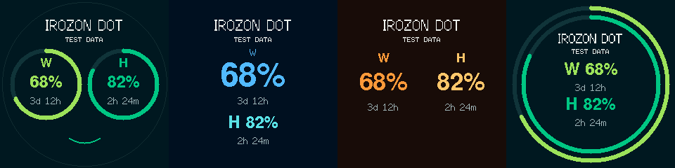

# Irozon Dot

A small round display for your Codex usage allowance, built with an ESP32-C3
Super Mini, a 240×240 GC9A01 display and a Windows Python companion.

**v1.0.0-rc.2 preparation:** source and a standalone Windows executable are
available locally. Nothing has been published. The repaired Windows executable now connects to the development device with
existing credentials. USB enrollment and final physical acceptance retain the
limits documented in the integration report. See [verified behavior and release gates](docs/validation.md).



Unflashed presentation improvements add adaptive/empty headings and a synchronized
Green blink and mouth movement. See [heading validation](docs/display-presentation.md)
and [face previews](docs/face-animation.md) for bounds, timing and physical acceptance limits.

These are simulated layout examples, not photographs or live account readings.
**W** means weekly allowance remaining; **H** means five-hour allowance remaining.
Countdowns show time until reset. Values are floored for whole-number display.

| Mode | Layout |
| --- | --- |
| Green Dashboard | Gauge eyes, a usage-sensitive mouth and an outer rim |
| Blue Minimal | Large weekly percentage and smaller five-hour percentage |
| Orange Numbers | Two large percentages without gauges |
| Classic Rings | Concentric weekly and five-hour rings |

## Get started

1. Check the [supported hardware and wiring](docs/hardware.md).
2. Build and [flash the firmware](docs/firmware.md). The live build never falls
   back to simulated values; the separate demo build always says TEST DATA.
3. Install and sign in to Codex CLI, then run the standalone Windows executable.
   No Python installation or script editing is needed for executable users.
   Follow [Windows installation and pairing](docs/windows-companion-distribution.md).
4. Optionally install the [Home Assistant package](docs/home-assistant.md) for
   display power, mode selection and following a chosen light.

The PC must remain awake and reachable on the same trusted private network.
Codex is the only supported provider. This is a usage display, not an AI chat
client; it sends no prompts and performs no inference.

## Controls and limits

In the prepared firmware, BOOT actions occur **on release**:

| Duration | Action |
| --- | --- |
| Under 40 ms | Ignore noise |
| 40 ms to under 2 seconds | Cycle Green → Blue → Orange → Classic |
| 2 seconds to under 8 seconds | Toggle display standby |
| 8 seconds or longer | Reset saved Wi-Fi and restart |

A long release never cycles modes. Hold BOOT while tapping RESET/EN to enter
the ROM bootloader. Existing flashed versions may have older gestures.
Mode and display power persist in NVS. Button and HTTP standby share one state.
Standby leaves Wi-Fi and usage polling active; it does not turn off the PC.

**Backlight limitation:** the verified seven-wire display has no controllable
backlight connection. OFF blanks the image and sleeps the panel, but its LEDs
remain illuminated. Neither a brightness setting nor an invented GPIO fixes
this. Read the [hardware findings and verified options](docs/hardware.md#backlight).

## How it works

The companion owns a local Codex app-server child over stdio and reads the
authenticated account's rate limits once per minute. It serves only normalized
allowance data, signed with a separate device key. The ESP32 fetches every 30
seconds and counts down locally. OpenAI account credentials remain with Codex.
The settings UI binds only to localhost; the LAN usage listener permits only the
configured device IP. See [architecture and security](docs/architecture.md).

Only the codex bucket with 300-minute and 10,080-minute windows is supported.
Missing or changed windows show unavailable instead of guessing. Stale/offline
data is marked explicitly; no quota refill is inferred locally.

## Develop and validate

Run from the repository root on Windows with Python and PlatformIO:

```powershell
python -m venv .venv
.venv/Scripts/python.exe -m pip install -r requirements-dev.txt
.venv/Scripts/python.exe -m unittest discover -s companion -v
.venv/Scripts/python.exe -m unittest discover -s scripts -p 'test_*.py' -v
pio run -e supermini -e demo
.venv/Scripts/python.exe scripts/preview.py
powershell -NoProfile -File companion/build-windows.ps1
.venv/Scripts/python.exe scripts/check_windows_executable.py
.venv/Scripts/python.exe scripts/release_audit.py --export
```

The preview is a bitmap/layout check, not a hardware emulator. Build dependencies
are pinned. Python remains the canonical companion; its provider factory exposes
only the implemented Codex provider. No frontend framework is used.

See [troubleshooting](docs/troubleshooting.md), [validation](docs/validation.md)
and the [repository/security audit](docs/release-audit.md). Do not publish local
pairing headers, JSON, logs, private HA YAML, firmware binaries or .git backups.

## License

Irozon Dot contributions are MIT licensed; see [LICENSE](LICENSE). Third-party
acknowledgments and required notices are collected in
[THIRD_PARTY_NOTICES.md](THIRD_PARTY_NOTICES.md). Dependency terms and firmware
binary redistribution gates are described in the [license inventory](docs/licenses.md).

This project is independent of OpenAI and the hardware/library authors.
