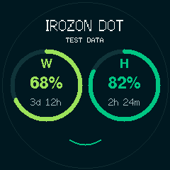
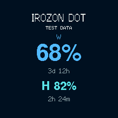
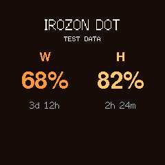
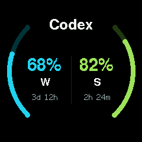

# Irozon Dot

Irozon Dot is a small round display for Codex five-hour and weekly usage. An
ESP32-C3 reads usage from the Windows companion and shows it in four layouts.
Codex remains responsible for sign-in; the companion does not send prompts.

The screenshots use sample values, not live account readings.

| Green Dashboard | Blue Minimal |
| --- | --- |
|  |  |

| Orange Numbers | Classic Rings |
| --- | --- |
|  |  |

## Parts and wiring

- [ESP32-C3 Super Mini](https://www.aliexpress.us/item/3256807018729495.html)
  with 4 MB flash
- [1.28-inch, 240×240 GC9A01 SPI round display](https://pl.aliexpress.com/item/1005004482028005.html)
- Seven jumper wires and a USB data cable
- Optional 3D-printed enclosure

Disconnect USB while wiring. Connect the display by its printed pin labels:

| GC9A01 display | ESP32-C3 Super Mini |
| --- | --- |
| VCC | 3V3 |
| GND | GND |
| RST | GPIO0 |
| CS | GPIO1 |
| DC | GPIO10 |
| SDA / MOSI | GPIO3 |
| SCL / SCLK | GPIO4 |

SDA and SCL are SPI signals here, not I²C. Do not connect unknown module pins
to 5 V. The [hardware guide](docs/hardware.md) describes the verified target
and supported-device limits.

For the enclosure, download the STL files and follow the original printable
enclosure and assembly reference on
[MakerWorld](https://makerworld.com/en/models/2872376-esp32-plane-radar-live-ads-b-on-a-round-display?from=recommend#profileId-3207083).
The STL files are linked there and are not redistributed in this repository.
Print the parts using the model's instructions, seat the display in the round
front opening, secure the ESP32 inside, and route the wires without pinching
them when closing the enclosure. Check the wiring before reconnecting USB.

## Windows companion

1. Install [Codex CLI](https://developers.openai.com/codex/cli). In PowerShell,
   run `codex login` and finish sign-in in the browser. Check it with
   `codex login status`, using the Windows account that will run Irozon Dot.
2. Download the Windows ZIP asset from a project GitHub release and extract the
   complete archive. Run `IrozonDot.exe`; Python is not required. Its settings
   page opens in your browser.
3. Discover the device or enter its IP address, pair it securely, and run
   **Test connection**. Choose one of the four display modes and optionally set
   a heading (up to 18 characters; an empty heading hides the title).
4. Turn on **Start with Windows** if desired. Keep this PC awake and connected
   to the same trusted network as the ESP32.

See the [Windows installation guide](docs/windows-companion-distribution.md)
for first-run setup, existing installations, security and troubleshooting.
The companion uses Codex's authenticated app-server interface; neither Codex
credentials nor Codex itself are bundled.

## Firmware

Install PlatformIO, connect the ESP32 by USB and build the live firmware:

```powershell
pio run -e supermini
pio device list
pio run -e supermini -t upload --upload-port COM3
```

Replace `COM3` with the port shown for your board. PlatformIO handles the image
offsets. Do not use `erase` when you want to preserve Wi-Fi, pairing and display
settings. See the [firmware guide](docs/firmware.md) for first boot, Wi-Fi setup,
pairing and recovery. `demo` is a separate build that displays TEST DATA.

## Optional Home Assistant

The built-in package provides a display power switch and four-mode selector.
It can also follow the state of one light or light group, including dashboard
changes. See [Home Assistant setup](docs/home-assistant.md) for the example YAML,
secret handling and configuration validation. OFF blanks and sleeps the LCD
panel; the backlight remains lit with the documented wiring.

## Controls and limits

In the current firmware, BOOT actions are classified on release: a short press
cycles modes, a hold of about two seconds toggles display standby, and a hold
of about eight seconds resets Wi-Fi settings. Hold BOOT while tapping RESET/EN
to enter the ESP32 bootloader. Do not use the eight-second hold unless you are
ready to configure Wi-Fi again.

**Backlight:** the seven-wire display has no connected backlight control. OFF
blanks the image and sleeps the panel, but cannot switch off its LEDs. The
[hardware guide](docs/hardware.md#backlight) explains the verified limitation.

The previously tested firmware image failed to wake from BOOT standby, although
HTTP and Home Assistant wake worked. Current source adds GPIO9 level sampling
to recover missed interrupt edges; the fix passes timing/state-machine tests and
both builds, but still needs physical confirmation after flashing. Until then,
use HTTP or Home Assistant to wake the tested unit. See
[troubleshooting](docs/troubleshooting.md).

## License

Irozon Dot contributions are MIT licensed ([LICENSE](LICENSE)). Required
third-party notices and component license terms are in
[THIRD_PARTY_NOTICES.md](THIRD_PARTY_NOTICES.md) and [docs/licenses.md](docs/licenses.md).
