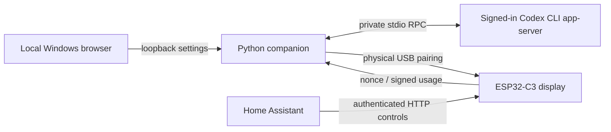

# Architecture and security

`companion/monitor.py` owns Source/Rpc and normalization. `providers.py` selects
that concrete source and rejects other providers. `desktop_runtime.py` is the
single HTTP server and settings owner, with separate loopback and explicit LAN
sockets. `settings.py` validates and atomically stores configuration; `app.py`
provides the source/frozen lifecycle. There is no second settings database/server.
`windows_control.py` scopes the mutex and stop event to the configuration path.
The old source controls remain available, but one configuration must have one
active owner. Import refuses an active legacy configuration.

## Codex dependency

Install Codex CLI and sign in as the Windows user running the companion. The
desktop Codex application need not stay open. The companion starts
`codex app-server --listen stdio://`, initializes the protocol, reads
`account/read` with `refreshToken: false`, then reads `account/rateLimits/read`.
These are documented in the [official app-server reference](https://developers.openai.com/codex/app-server).
It uses the CLI's existing managed ChatGPT authentication; it does not implement
its own OAuth flow, inspect Codex credential files, expose app-server on the LAN,
or call private ChatGPT backend URLs. No account email is persisted or forwarded.

The implementation accepts ChatGPT-managed sign-in and the `codex` bucket only.
It maps windows by duration, not array position: 300 minutes and 10,080 minutes.
Remaining percent is `100 - usedPercent`; reset times are Unix seconds. Unknown
schemas/windows fail closed. API-key-only accounts and other quota buckets are
not supported. Account availability and upstream schemas can change independently
of this project. The companion does not request model inference or spend reset
credits. Codex authenticates its own upstream requests.

## Boundaries

- Settings: 127.0.0.1:8788, strict Host/Origin, session cookie, CSRF token,
  resource policy, request limits, no CORS or third-party web assets. Top-level
  root navigation is allowed; cross-site API writes are rejected. This assumes
  a trusted local computer and does not defend against hostile local processes.
- Usage: specific PC LAN IPv4:8787, only the configured device source IP.
  HMAC-SHA256 signs the normalized payload including a fresh ESP32 nonce. No key
  is transmitted in that request. Payloads are not encrypted.
- ESP32 controls: port 8080 on the station network, dedicated bearer token,
  optional source allowlist, bounded commands, no control listener on the setup
  AP. Commands are queued; poll confirmed state instead of assuming success.
  Bearer HTTP is plaintext: a LAN observer may capture the control credential.
  Never expose these ports to the internet or an untrusted network.
- Pairing: physical USB only, challenge and a 60-second application-boot window.
  Independent random usage/control keys are stored atomically in `irozon-link`.
  Existing compiled settings remain a fallback. Pairing does not reset Wi-Fi.
- Storage: newly saved Windows secrets use per-user DPAPI and restricted ACLs.
  Legacy plaintext files load without automatic rewriting. ESP32 NVS and compiled
  headers are not encrypted storage; physical access can expose keys.

Usage freshness is cached on the PC; the device marks old samples stale after
150 seconds. Reboot does not restore an old usage sample as live. Usage fetching
never changes display power; button and HTTP commands both use `ui::setDisplayOn`.
The optional HA follower watches a light's state, not a button event, and sends
only display commands on light changes/startup/recovery.

No credential values or raw upstream/serial error bodies belong in logs. Explicit
HA credential downloads contain a real secret and must remain private. Reset or
re-pairing is not a remedy for a simple reachability error.
