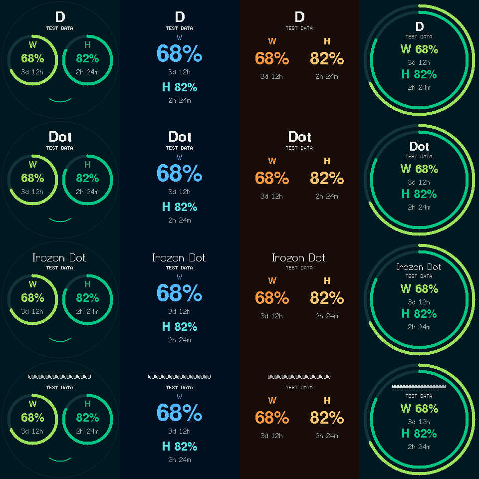
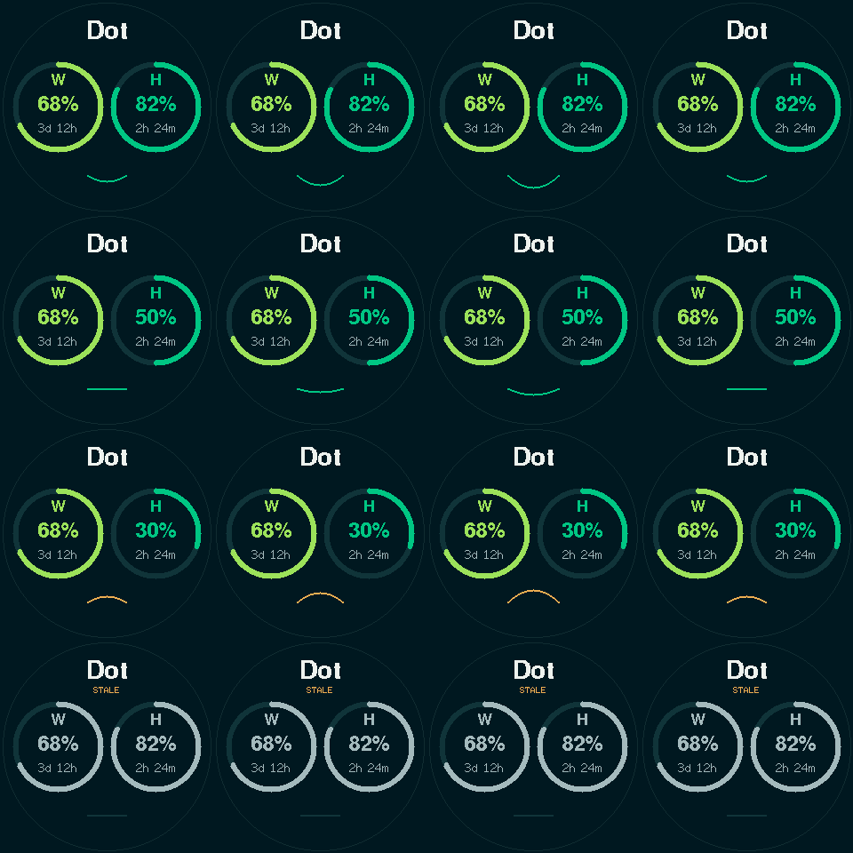
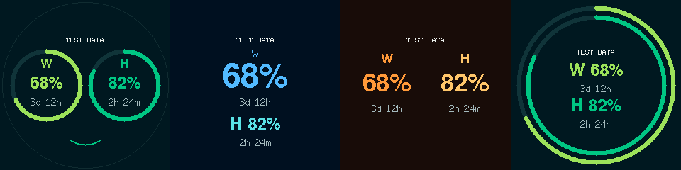

# Adaptive heading and gentle mouth movement

Prepared on 2026-10-21. These presentation changes have not been flashed or
verified on the physical panel. The running Windows companion, Home Assistant,
startup task, pairing and saved device settings are unchanged.

The heading retains its center at (120, 36), or (120, 55) in Classic. The renderer
tries descending text heights using the existing FreeSans Bold 12/9, Font2 and
Font0 fonts. LovyanGFX measures the actual string width at each candidate scale.
It chooses the largest fitting height, with ink/rounding margins, a circular
safe chord and a gap above the existing status label. Font scaling is restored
before drawing other text. Clearing the previous heading's bounds also removes
old letters when the name becomes shorter.

Short names such as `Dot` get a 28-pixel font height, or 24 pixels in Classic,
instead of the old 8-pixel custom-name font. Wider names scale down; all 18
supported printable ASCII characters remain supported. Worst-case wide names
need compact bitmap text, particularly inside Classic's rings. Font metrics
include room for descenders; visible letter height varies with the name.

Green's existing expression thresholds remain happy above 55%, neutral from
45% through 55%, and sad below 45% of H remaining. Missing, stale, offline or
otherwise unreliable H stays dim neutral and does not animate.

After approximately 10 seconds of eligible Green display time, the mouth's
curve eases through a seven-pixel curvature change over one second and returns
to the expression for the current H reading. Standby, changing mode or losing
reliable H cancels it; returning starts a fresh 10-second wait. A due animation
can be deferred until the existing usage fetch has enough time before its next
scheduled poll. Cosmetic work never delays a fetch or button processing.

The animation uses unsigned elapsed time, skips missed intermediate frames,
and has no delay, allocation, NVS write or full-screen redraw. Only changes in
curve depth repaint the mouth, using the existing 80 by 30 percentage sprite
(no additional buffer). If that existing sprite allocation fails, the existing
direct drawing fallback may show a small erase/draw artifact. Firmware scheduling
is cooperative: existing Wi-Fi/control/network work can delay a frame, so the
one-second duration is a software target rather than a hard real-time guarantee.

[Neutral animation](mouth-neutral.gif) and [sad animation](mouth-sad.gif) are also
240 by 240. Curvature and half-width both increase by seven pixels at the peak;
happy and sad curves deepen in their existing direction, while neutral gains a
small smile. Percentages and reset labels stay stationary. The Green ring graphics
now also blink; see [blink behavior and performance](face-animation.md).

The GIF uses the actual one-second movement and ten-second start interval. These previews use the pinned bitmap fonts at 240 by 240. They
are host layout checks, not an SPI emulator or proof of physical-panel smoothness.
Fractional font rasterization can differ slightly from the panel driver.

Validation covers printable ASCII at one and 18 characters, every intermediate
wide-name length, ink bounds, circular margins, status separation and mouth-only
pixel differences for all four layouts. Production C++ static assertions cover
animation cadence, the one-second boundary, cancellation/resume, deferred starts
and millis rollover. Both firmware variants compile these checks. Existing
button/power/Wi-Fi-reset checks remain in place.

Both firmware builds passed, with 32 companion tests and 16 repository tests
passing. The complete preview checks also passed, including 0–100 percentages
and compact reset labels. The source privacy/local-link audit passed.

| Environment | Static RAM | Application flash |
| --- | --- | --- |
| supermini | 43,300 bytes | 1,020,202 bytes |
| demo | 43,100 bytes | 982,036 bytes |

No additional sprite allocation or font dependency was introduced. The clean
build retains the upstream Arduino UART return-without-value warning; there
were no project build errors.

Physical acceptance after an approved flash still needs checking: font appearance
on the GC9A01, smoothness, live H changes during animation, mode switching and
standby/wake during a movement. No flash or physical interaction is part of the
host validation.

## Empty heading semantics

A missing setting uses `IROZON DOT` for a new installation. An explicit empty
string, including input trimmed to empty, means no heading. Nonempty names retain
the 18-character limit and adaptive sizing. Existing JSON with an empty heading
is treated as an explicit choice; no guess about the user's earlier intent is made.

Windows validation trims whitespace and stores the empty value. The settings
page defaults only a missing/null value, never an empty string. Signed usage HTTP
includes `"heading":""`; omission remains distinct. USB enrollment transports
only the existing link credentials, so heading changes do not open a serial port,
require enrollment or rotate keys.

Firmware validates the heading separately and marks its presence. A missing
field retains the previous heading. An explicit value is persisted under
`irozon-ui/heading`, even in standby. The existence of that NVS key distinguishes
an unset heading from a saved empty string. Boot restores it before drawing, so
an offline restart does not temporarily substitute a default title. Empty clears
the old heading's bounds; no other title or placeholder is rendered. Other layout
coordinates stay unchanged.

Temporary-config tests cover missing/default, empty, whitespace, bounds, actual
loopback save/state requests, encrypted storage and a new Runtime instance.
`node scripts/check_heading_ui.cjs` executes the actual settings JavaScript with
a minimal DOM stub to check reload and submission semantics; it is not a full
browser acceptance test. Production C++ assertions check normalization/presence,
and source contracts check the NVS path and standby ordering. Actual NVS power
cycling and panel appearance remain unverified until an approved flash. Wait for
the next authenticated device fetch (up to 30 seconds) before expecting a newly
saved heading to survive a device restart.

The running Windows executable is unchanged. The latest settings source has been
built and validated as an isolated executable candidate; installation and the
approved firmware update remain pending.
Two earlier companion-suite runs encountered transient HTTP timeout/host-abort
errors; an unchanged sequential rerun passed all 32 tests.
