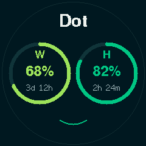
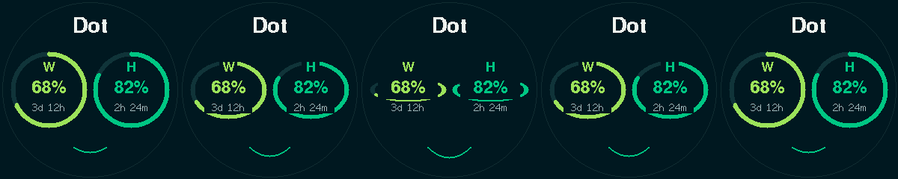

# Green Dashboard blink and expression

The Green face uses one nonblocking clock: starts are approximately ten seconds
apart, with a one-second sequence. The seven-pixel mouth curvature/half-width
movement retains the H-based happy, neutral and sad expressions. Both eyes use
the same smoothstep blink, closing between 200 and 500 ms and reopening by
800 ms. Their vertical radius changes from 51 to 16 pixels; horizontal radius,
text positions and actual usage readings do not move.

The percentage, W/H label and countdown rectangles are masked out of every eye
transfer, keeping their existing pixels stationary and readable. The compressed
outline passes behind those text areas, so a closed eye remains partly hidden
by the unchanged percentage. Progress angles map through the vertical scale;
no usage value or countdown is changed to create the blink. The normal circular
renderer is reused at restoration, including its rounded progress endpoints.

Standby, a mode change or unreliable H or W cancels the face sequence. Returning
to eligible Green starts a fresh ten-second wait. Static expressions still follow
H when H alone is reliable. Stale/unknown H retains its dim neutral expression.
Blue, Orange and Classic have no face animation.

## Rendering and performance

The existing 80 by 30 RGB565 sprite (4,800 bytes) is reused in clipped tiles. Each
eye needs at most eight tile transfers; a face frame may add one mouth-strip
transfer. Background and arc pixels are composed before each transfer; there is
no full-screen erase, display readback, new sprite allocation or blocking delay.
Masks preserve both the text and everything outside the original circle's raster
envelope, including the outer rim. If the existing sprite allocation fails, the
blink is disabled and the existing mouth drawing fallback remains available.

Intermediate face updates are limited to one every 40 ms (25 per second), and
unchanged shapes skip drawing. Cancellation/restoration is immediate rather than
waiting for that frame limit. Missed frames are skipped; the existing usage poll
and button handling retain priority. Network work is cooperative and can delay a
frame; panel smoothness and measured ESP32 frame times await an approved flash.

Static RAM is 43,300 bytes for supermini and 43,100 for demo, increases of 16 and
8 bytes respectively. Both application binaries grew by 3,572 bytes (now
1,020,202 and 982,036 bytes). No additional framebuffer or graphics dependency
was introduced. The added CPU/SPI work is limited to the short face sequence;
on-device profiling has not been performed.

## Validation

Both firmware builds pass. Production C++ assertions cover timing, cancellation,
resume, deferred starts, rollover, easing and synchronized blink endpoints.
Host pixel checks verify every label/percentage/countdown rectangle through the
sequence, exact first/last frame identity, clipping, all integer progress endpoints
under every compression and cancellation for unreliable readings. All four
resting mode previews are byte-for-byte identical to their preceding versions.

The GIF is exactly 240 by 240 and lasts ten seconds per loop, including the
one-second movement. It uses pinned font data and is a layout preview, not a
GC9A01 emulator. No firmware was flashed. Windows companion source/executable,
Home Assistant and authentication/usage retrieval sources remain unchanged.
